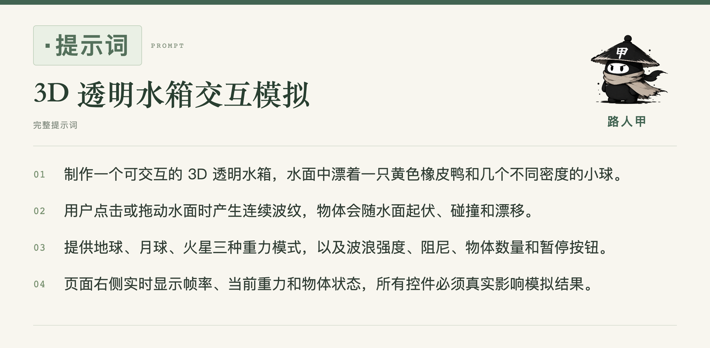

# 公众号提示词宽图 · 路人甲

把完整提示词排成**一张高清宽图**，直接插入公众号文章。短文用大字号单栏，长文在同一张图里分栏；默认保留醒目的「提示词」标识、路人甲署名和 IP 形象。

这是一个 Codex Skill，也可以作为本地命令行排版工具使用。它负责展示提示词，不会执行提示词中的开发、运行或上传指令。



## 样式

- 奶油白底、深绿色文字、细线分隔。
- 1200px 画布中的「提示词」标识为 40px 粗体；长文宽画布按比例放大。
- 每条完整提示词只输出一张 PNG，不拆成卡片组。
- 保留正文、章节、编号和代码文本，默认不摘要、不改写。
- 原图默认导出 2 倍分辨率，另存可编辑的自包含 HTML 和检查报告。

超长提示词仍需放大原图阅读；单张图不等于手机缩略图能显示全部细节。

## 安装为 Codex Skill

下载或克隆本仓库，运行：

```bash
git clone https://github.com/ZSeekin/wechat-prompt-image.git
cd wechat-prompt-image
python3 install.py
```

安装器默认复制到 `${CODEX_HOME:-~/.codex}/skills/wechat-prompt-image`。已有同名技能时会停止，不覆盖原文件。也可以把技能父目录作为第一个参数传入。

首次安装渲染依赖：

```bash
cd "${CODEX_HOME:-$HOME/.codex}/skills/wechat-prompt-image"
npm ci
# 已安装 Google Chrome 时可以直接使用；否则安装 Playwright Chromium：
npx playwright install chromium
```

需要 Node.js 20 或更新版本、Chrome/Chromium 和可显示中文的系统字体。macOS 可使用苹方，Windows 可使用微软雅黑，Linux 建议安装 Noto Sans CJK。字体不会随仓库下载。

在 Codex 中使用：

```text
请用 $wechat-prompt-image 把下面的提示词做成一张宽图，保留完整原文：

（粘贴提示词）
```

## 命令行使用

在仓库根目录安装依赖并生成水箱示例：

```bash
npm ci --prefix wechat-prompt-image
node wechat-prompt-image/scripts/render.cjs \
  --input examples/water.md \
  --title "3D 透明水箱交互模拟" \
  --output output/water.png
```

更换为自己的署名和形象：

```bash
node wechat-prompt-image/scripts/render.cjs \
  --input examples/pelican.md \
  --title "澳洲鹈鹕海边骑行" \
  --author "你的名字" \
  --avatar /absolute/path/to/your-avatar.png \
  --output output/pelican.png
```

更多参数见 [渲染用法](wechat-prompt-image/references/rendering.md)。渲染只读取本地输入和图片；不会下载素材，也不会把正文发送到外部服务。

## 示例与检查

| 示例原文 | 单张图片 | 内容规模 |
| --- | --- | --- |
| [3D 透明水箱](examples/water.md) | [查看图片](examples/water.png) | 4 段 |
| [澳洲鹈鹕骑行](examples/pelican.md) | [查看图片](examples/pelican.png) | 4 段 |
| [2D 恐怖逃生游戏](examples/horror.md) | [查看图片](examples/horror.png) | 13 个章节、105 个列表项 |

渲染器核对可见文字与解析后的原文、画布横向比例、图片加载及内容越界。修改版式后仍需查看图片，尤其是长文的原尺寸局部。

三个示例已经实际渲染并查看，长例的 105 个列表项校验通过。可用 `node --test tests/renderer.test.cjs` 检查重复标点、复制的 Markdown 转义、代码路径和 HTML 字面内容是否完整保留。

## 目录

```text
wechat-prompt-image/
  SKILL.md                 技能说明
  agents/openai.yaml       Codex 展示信息
  scripts/render.cjs       本地渲染器
  assets/                  样式、默认 IP 与来源说明
  references/rendering.md  参数与运行说明
  package.json             渲染依赖
examples/                  三份完整原文与实际渲染图片
install.py                 不覆盖已有技能的安装器
```

代码与技能文档使用 MIT 许可证。路人甲 IP、名称及含品牌形象的示例图片不纳入代码许可证，参见 [品牌资产说明](wechat-prompt-image/assets/NOTICE.md)。
